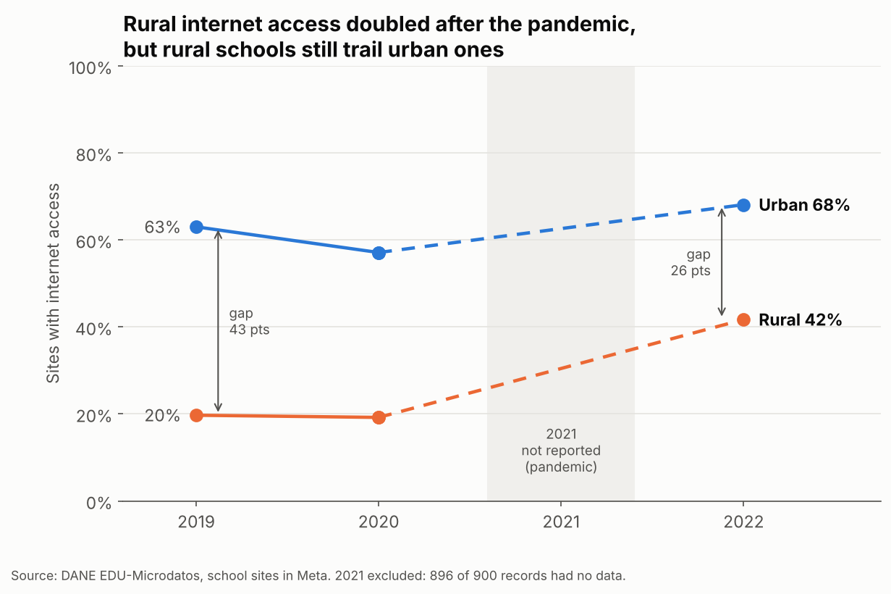
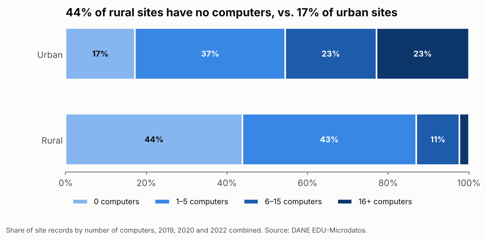
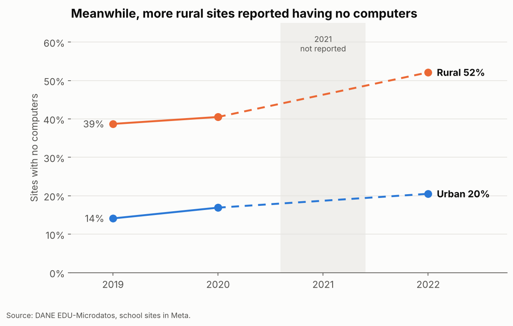

# Digital Divide in Rural vs. Urban Schools — Meta, Colombia (2019–2022)

**Did the COVID-19 pandemic close or widen the digital gap between rural and urban schools?** This project analyzes 3,549 school-site records from Colombia's national statistics office (DANE) for the department of Meta, before, during and after the pandemic.

## Key findings

- **Rural internet access doubled:** rural sites with internet rose from 20% (2019) to 42% (2022). Overall, sites without internet fell from 71% to 53%.
- **The gap narrowed but did not close:** the urban–rural difference shrank from 43 to 26 percentage points and remains statistically significant (chi-square, p < 0.001).
- **Equipment did not follow connectivity:** urban sites have a median of 5 computers vs. 1 in rural sites, and the share of rural sites with no computers rose from 39% to 52%.
- **2021 was a data blackout:** 896 of 900 site records have no ICT data for 2021, which shows how the pandemic disrupted education information systems.

The trends hold for the same 828 schools observed in every reported year, so they are not caused by changes in the sample.

|  |  |
| --- | --- |

## Data

- **Source:** DANE, [EDU-Microdatos: Educación Formal](https://microdatos.dane.gov.co/index.php/catalog/EDU-Microdatos) (retrieved March 2026).
- **Scope:** school sites in Meta's 29 municipalities, 2019–2022.
- **Variables:** site code, year, municipality, rural/urban area, internet access (yes/no), number of computers.

## Method

1. **Cleaning:** removed 9 duplicate rows; excluded 2021 from rates instead of filling missing values with zeros, which would have biased every average down.
2. **Exploratory analysis:** internet access and computers per site by area and year.
3. **Statistical tests:** chi-square (internet access by area, and rural 2019 vs. 2022) and Mann-Whitney U (computers by area).
4. **Robustness check:** repeated the key figures for the balanced panel of schools present in all reported years.

**Tools:** Python (pandas, NumPy, SciPy, Matplotlib).

## Limitations

The analysis is descriptive, not causal. Internet access is a yes/no flag with no information on speed, and computers are an absolute count rather than per student. A rising "zero computers" share could partly reflect changes in how sites report equipment.

## Policy recommendations

1. Pair rural connectivity programs with device provision.
2. Prioritize rural sites that still have neither internet nor computers.
3. Strengthen ICT reporting so that a crisis year does not become a blind spot for policy.

## How to run it

Open `analysis.ipynb` in [Google Colab](https://colab.research.google.com/) or Jupyter, upload `Data_Meta.csv` next to the notebook, and run all cells.

## Team

Developed in the Talento Tech Data Analysis program (Colombian Ministry of ICT), February–April 2026:

- **Mayra Valentina Gamboa Zárate** — research lead; cleaned and re-verified this version ([LinkedIn](https://www.linkedin.com/in/mgamboaz))
- **Jorge Manzur Salamanca Chidiak** — technical lead
- **Katherin Ortega Pertuz** — data analyst
- **Gisel Sthepfany Serna Montenegro** — data analyst

---

**Resumen en español:** análisis de la brecha digital en colegios rurales y urbanos del Meta (2019–2022) con microdatos del DANE. El acceso a internet en sedes rurales se duplicó (de 20% a 42%) y la brecha con las urbanas se redujo de 43 a 26 puntos. Sin embargo, la proporción de sedes rurales sin computadores subió de 39% a 52%: la conectividad mejoró, pero el equipamiento no.
